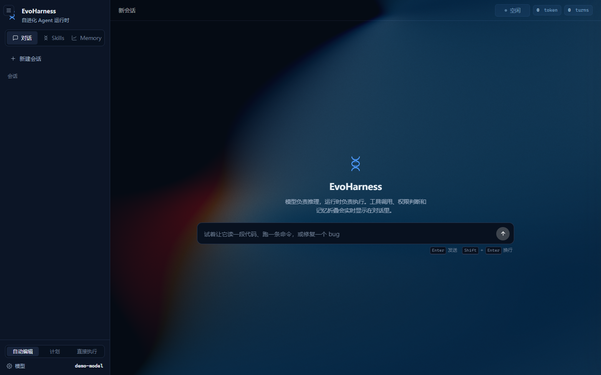
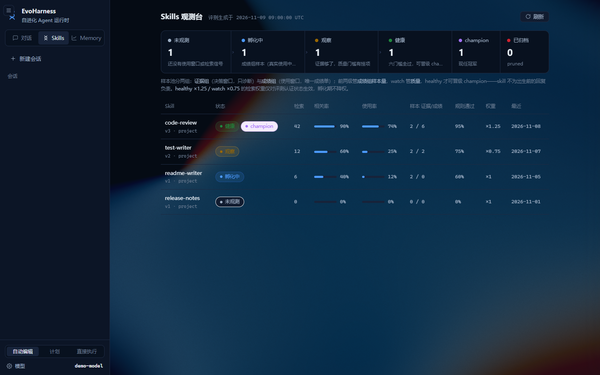
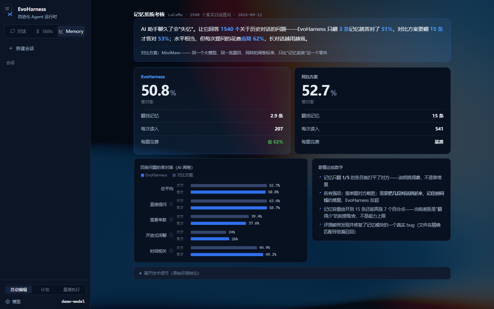
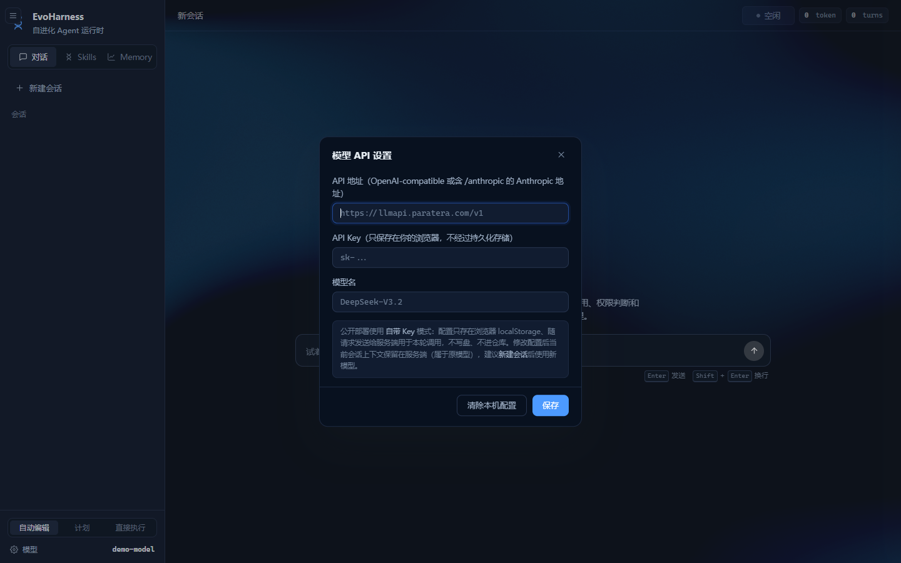
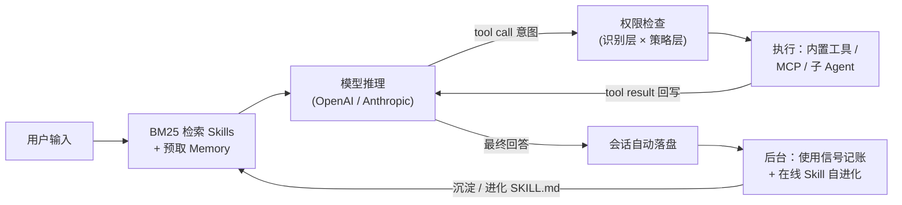

<p align="center">
  
</p>

<h1 align="center">EvoHarness</h1>

**模型提出意图 · 运行时决定执行 · 进化要有证据**

[](https://github.com/Nagrax/EvoHarness/actions/workflows/ci.yml)
[](https://www.python.org/)
[](https://fastapi.tiangolo.com/)
[](https://platform.openai.com/)
[](./LICENSE)

把大模型变成可靠的 coding agent，缺的不是推理能力，而是一个可控的运行时：上下文怎么管理、工具怎么放权、经验怎么沉淀、沉淀的质量怎么证明。EvoHarness 的核心运行时用约 16,000 行 Python 回答这四个问题，提供 **CLI / Web / 桌面** 三种使用形态，支持 OpenAI / Anthropic 双协议；更进一步，它把这套运行时放进可复跑的评测与迭代闭环里，让"进化"有证据、可回退、可审计。

## 项目状态（2026-11）

| 维度 | 当前状态 |
| --- | --- |
| 核心运行时 | `agents/` 28 个模块、16,131 行；CLI / Web / 桌面共用同一套 Agent Loop |
| Web 工作台 | 2026-10 工作台重设计：零构建单文件，对话 / Skills / Memory 三视图 + 侧栏会话与权限模式 + 顶栏 HUD（状态 / token / turns）+ BYOK 模型设置；Skills 六门槛抽屉与加载异常修复；Memory 对比图表 |
| 测试与 CI | 137 个测试文件、20,667 行；本地全量 1,195 passed / 2 skipped；GitHub Actions 覆盖 Linux + Windows、Python 3.11/3.12，Windows 默认非 UTF-8 编码单独一组门禁 |
| Agent benchmark | GAIA 165 题 **49.1**（95% CI 41.2–57.0）；HLE n=75 **10.7**（4.0–17.3）；A 级冻结口径，产物可离线复算 |
| 自迭代闭环 | `eval/loop/` 已运行 35 轮、37 条 finding，34 条按复测证据闭合；余 3 条为信息型或需付费预算复测 |
| 飞书日报 Agent | 独立子系统 `feishu-daily-agent/`（85 个跟踪文件）：日报 / 经验库 / 卡片审批 / 四级运行模式；已进入 owner 放行的最小白名单灰度，F08 真实自然日 3/7、F09 冻结留出集 auto 候选 2 个（门槛 60），统计门槛未满足 |
| 证据纪律 | A/B/C/D 四级；D 级结论不对外宣称，B/C 必须标注 |

## 先看证据

三层证据链，从 benchmark 数字到可自动复跑的测试：

| 层 | 结果 | 等级 | 对照 / 产物 |
| --- | --- | --- | --- |
| **Agent benchmark**（GAIA 165 题，冻结口径 Pass@1） | **49.1**（95% CI 41.2–57.0；有效作答准确率 63.8） | A | HiRA 42.1；自建可复现 runner（`eval/`）。唯一产物：`eval/runs/gaia/scores/20261019T083454Z-c24288.json` |
| **Agent benchmark**（HLE，n=75 有效） | **10.7**（95% CI 4.0–17.3；有效作答准确率 25.0） | A | HLE 为 frontier-killer 基准；原 100 题子集 25 题因平台 403 未跑，单列不计入分母。唯一产物：`eval/runs/hle/scores/20261019T083458Z-f93a86.json` |
| **会话折叠消融**（GAIA 165 题配对，McNemar） | 51.5 / 40.0（p=0.011，历史口径） | **C（产物已丢失，仅存文档记录，不可对外宣称）** | 强制高频折叠消除全部上下文超限，但降低完成率——定位"保活有效、保质为负"的结构性权衡，驱动修复方向 |
| **记忆系统**（LoCoMo 1540 问） | 1/5 检索量持平答对率（judge 50.8% vs 52.7%），token **-62%** | C（外部 harness，数据集不在本仓库，无法在此复跑） | MiniMem 向量检索基线；评测直接定位并修复了 P0 召回丢失 bug |
| **记忆生命周期 A/B**（10 查询 × 2 批 × 3 臂，真实模型） | 软标注**消除污染**（−2 事件，两批极差 0）；硬过滤**省 ~10% tokens**但**损失 8.4pp 召回** | A | 跨批次噪声门判定 `claimable`；软标注的召回收益为 **D 级不可宣称**（方向反号） |
| **Skills 自进化三臂**（两批 12 轮 × 3 臂） | ungated +5.6/+2.8pp；gated +5.6/+3.3pp；进化开销 6.4–7.4% | A（效应约 4pp、命中稀疏、未随技能累积增长；"未观察到增长"为 B 级） | `eval/` 可复跑；Spearman ρ=−0.213（n=24、总命中 4 次，只能称"未观察到增长"） |
| **回归防线** | 本地全量 1,195 passed / 2 skipped + CI（Linux + Windows） | — | `tests/` 全量离线测试，push 即自动验证；Windows 默认（非 UTF-8）编码单独一组门禁 |

> **证据强度分级**（A 可对外声明 / B 单批次 / C 外部不可复跑或产物缺失 / D 不可宣称）逐项定义见 [`eval/RESULTS.md` §六](eval/RESULTS.md)。任何对外文档出现 D 级结论即为不合格；B/C 级必须带标注。

> **评测口径（冻结于 2026-10-19）**：`pass_at_1 = 正确数 /（计划题数 − 平台不可用题数）`；超时、执行错误、无最终答案**均计为失败**。有效作答准确率（`valid_answer_accuracy = 正确数 / 可判分数`）单列，不与主指标混用。判分器版本固定为 `matcher:gaia_match+hle_match@2026-09-18`。每次运行生成独立 `eval/runs/<tag>/runs/<run_id>.json`（代码版本/工作树差异/模型/权限/数据哈希/题单/预算/判分器版本/原始痕迹哈希）；每次判分生成**不可变**派生物 `eval/runs/<tag>/scores/<score_run_id>.json`，`summary.json` 只作最新指针，绝不覆盖原始预测轨迹。

## 三种使用形态，一套运行时

<p align="center">
  
</p>

| Skills 观测台 | Memory 考核页 | BYOK 模型设置 |
| --- | --- | --- |
| [](docs/screenshots/skills.png) | [](docs/screenshots/memory.png) | [](docs/screenshots/settings.png) |

> 截图用于展示界面结构；Skills 页数据与模型名称为演示配置，Memory 数据来自仓库内 LoCoMo 评测。

- **CLI**：`python -m agents.main`——REPL、一次性任务、Plan Mode、`--resume` 会话恢复
- **Web**：`python -m server.app`——FastAPI + SSE 事件桥，`agents/` 核心零改动接入；前端是零构建单文件工作台（`frontend/index.html`）
- **桌面**：双击 `desktop.pyw`——pywebview 原生窗口，关窗即退

Web 工作台默认进入对话：左侧侧栏负责 **对话 / Skills / Memory** 三视图切换、新建会话、历史会话、权限模式（自动编辑 / 计划 / 直接执行）与模型 API 设置；顶栏 HUD 实时显示运行状态、本轮 token 与 Agent 轮次；输入框在空态居中，发送后切换为 SSE 工具调用时间线，工具卡可折叠、代码可复制、运行中可停止。

Skills 观测台把状态机变成可操作的数据：五级分布带与 champion/归档计数、按"距晋级差几项"排序的表格、点击行打开详情抽屉（六门槛仪表、差距诊断、生命周期、证据/成绩双组样本、候选变体、使用事件），SKILL.md 加载异常在面板内给出建议修复与一键应用。Memory 页把 LoCoMo 1540 问的评测做成结论横幅、双方对比大卡、四类问题条形图和"看懂这组数字"，原始结论可展开；抽屉细节见 [`skills-detail.png`](docs/screenshots/skills-detail.png)。

模型 API 设置采用 BYOK：API 地址 / Key / 模型名只保存在浏览器 `localStorage`，随请求发送给服务端用于本轮调用，不写盘、不进仓库；服务端默认额度与访客自带 Key 的提示会在左下角模型状态中体现。会话历史自动落盘（`~/.evoharness/sessions/`），服务重启或换机后点击侧栏旧会话即可恢复完整上下文。

## 运行时链路



## 快速开始

```bash
git clone https://github.com/Nagrax/EvoHarness.git
cd EvoHarness

python -m venv .venv
# Windows:
.venv\Scripts\activate
# macOS / Linux:
source .venv/bin/activate

pip install -r requirements.txt
cp .env.example .env          # Windows PowerShell: Copy-Item .env.example .env
# 编辑 .env，至少填 APIKEY / API / MODEL
python -m server.app          # Web：http://127.0.0.1:8800
```

Docker 镜像默认即 Web 服务（容器端口 7860）：

```bash
docker build -t evoharness .
docker run --rm -p 7860:7860 --env-file .env evoharness
```

CLI 与桌面：

```bash
python -m agents.main                         # 交互式 REPL
python -m agents.main --plan "..."            # Plan Mode：先出计划再执行
python -m agents.main --resume                # 恢复最近会话
python desktop.pyw                            # 桌面窗口；Windows 也可双击 start_web.bat 启 Web
```

协议由 base URL 自动判断（路径含 `/anthropic` 走 Anthropic 协议）。换用其他模型或代理时，若上下文窗口与内置假设不符，可设 `EVOHARNESS_CONTEXT_WINDOW` 显式指定；未知模型默认按保守窗口处理（宁可早折叠，不可撞 413）。

> [!WARNING]
> `.env` 已被 `.gitignore` 忽略，切勿提交 API key。公开部署时建议不配环境变量，
> 使用前端 BYOK 模式让访客自带 key。

## 六个模块，一条演进链

按依赖顺序：**先能跑 → 扛得住长任务 → 安全 → 记得住 → 会学习 → 证明学得对**。两块地基（①③）承载两条研究线（记忆线②→④、进化线⑤→⑥）。

| # | 模块 | 核心问题 | 代表机制 | 主要代码 |
| --- | --- | --- | --- | --- |
| ① | 透明 Agent Loop | 消息历史每个字节可控 | 双协议、流式 tool 参数拼装、每轮落盘 + `--resume` 读档修复 | [`agents/agent.py`](agents/agent.py) |
| ② | 上下文压缩与会话折叠 | 长对话不丢任务状态 | 三层无损压缩优先、70% 硬阈值折叠为 episode/working/tool 三层结构化记忆；折叠强制保留文件路径/已否定结果/下一步动作/用户约束四类硬状态，摘要附存档路径可 `read_file` 恢复 | [`agents/session_memory.py`](agents/session_memory.py) + [`agents/agent.py`](agents/agent.py) |
| ③ | 工具权限与能力扩展 | 模型意图与环境动作隔离 | 识别层×策略层五档权限、Plan Mode、read+mtime 乐观锁、自研 MCP（全工具带安全注解）、三粒度子代理 | [`agents/tools.py`](agents/tools.py)、[`agents/mcp_client.py`](agents/mcp_client.py)、[`agents/subagent.py`](agents/subagent.py) |
| ④ | 长期记忆 | 跨会话记住会消失的信息 | markdown 记忆文件 + 两段式召回（程序扫清单、模型挑文件）+ 硬预算 | [`agents/memory.py`](agents/memory.py) |
| ⑤ | Skills 在线自进化 | 从反馈沉淀可复用能力 | 下一轮反馈作证据、add/merge/revise/discard 四路决策、provenance 溯源；待抽取窗口按 session 落盘（租约 300s、最多 3 次尝试），进程退出/Web 重连后不丢窗口 | [`agents/online_skill_evolution.py`](agents/online_skill_evolution.py)、[`agents/extraction_window.py`](agents/extraction_window.py) |
| ⑥ | 离线评测与状态机 | 证明沉淀的质量 | 证据组/成绩组双池（使用窗口=唯一成绩单）、程序规则+LLM judge 双轨、五级状态机、champion 人工晋级 | [`agents/online_skill_eval.py`](agents/online_skill_eval.py) |

**状态机已接回运行时**：评测物化状态表，检索按认证状态加权（healthy ×1.25 / watch ×0.75，孵化期不降权防饿死）；孵化期注入打 provisional 标注并禁 fork；沉淀 14 天零检索自动归档；矛盾偏好走 revise 整体替换；被检索即落一份使用窗口样本（relevant/used 是标注不是门槛，"被检索但没用"也记）——它是评测成绩组的唯一考卷。Web 端「Skills」观测台把这套判定变成可点击的数据：五级分布带、按"距晋级差几项"排序的列表、六门槛仪表（当前值 vs 门槛逐项对比）、结合 `last_reason` 的差距诊断。

## 自迭代闭环：评测不是报告，是待办

`eval/loop/` 是一套能自己发现问题、自己收缩 backlog 的编排器：

```text
评测(collect) → 差异(finding) → 判读(triage) → 排期(backlog) → 实现 → 复测 → 回归门禁
```

- **命令**：`python eval/loop.py status` / `collect` / `next` / `start <id>` / `done <id> --note "复测证据"` / `block <id> --reason "..."` / `report`
- **状态机**：`pending → in_progress → done/blocked`，认领带 45 分钟租约；**同一 finding 复测后不再出现才算 done**，绝不批量闭合
- **可比较**：每轮落盘快照含 `sourceDigest`，跨轮可对比；未达 done 的 item 保持 pending/blocked
- **多信号源**：后端契约、前端逐按钮、模块扫描、失败稳定性、飞书黄金回放（`eval/feishu_signal.py`）。缺产物、过期产物、评测崩溃都必须可见；干净与坏掉不能外观相同
- **信号源健康**：`eval/loop_source_health.py` 用"历史有产出 + 底层脚本 exit 0"双判据；脚本跑不通=坏，能跑但无产出=干净
- **当前台账**：35 轮、37 条 finding，34 条按复测证据闭合；余 3 条为信息型 finding 或需付费基准预算的复测项，不伪装成完成

接手入口见 [`docs/CLOSED-LOOP-TAKEOVER.md`](docs/CLOSED-LOOP-TAKEOVER.md)，实时状态见 [`eval/loop/BACKLOG.json`](eval/loop/BACKLOG.json)。

## 飞书日报 Agent：运行时之外的独立产品子系统

[`feishu-daily-agent/`](feishu-daily-agent/) 是独立的飞书日报与经验回复 Agent（Python + 飞书 SDK + SQLAlchemy + SQLite，自带 Dockerfile、compose、测试与评测），与根仓库共享同一套证据标准：

```text
飞书消息（长连接事件 + 每日历史拉取兜底）
  → 分类（question / task / notice）
  → 经验库匹配（embedding 或 jieba 关键词）
  ├─ 高置信度 + 已验证经验 → 自动回复，日报备查
  └─ 中低置信度 / 无命中   → 生成草稿进日报
  → 日报卡片（待办 + 待批 + 已发 + 新经验）
  → 人工批示（批准 / 驳回 / 修改 / 验证 / 停用）
  → 回写经验库，迭代置信度与状态
```

| 运行模式 | 真实飞书读写 | 放行条件 |
| --- | --- | --- |
| 离线 | 合成事件、脱敏 fixture、假时钟、假模型与假传输 | 工程默认测试入口 |
| 只读与影子 | 读取已授权来源，允许向 owner 发日报，业务回复只生成决策和草稿 | 真实读权限矩阵、日报收件人和部署配置已确认 |
| 逐条批准 | owner 审核具体回复版本后，向批准的原会话发送 | 审批身份、发信身份、重复回调和故障恢复均通过 |
| 白名单自动 | 只在许可会话和 FAQ 类别发送已放行版本，日报展示实际发送结果 | 固定留出集、影子试点、风险门禁和 owner 的模式放行 |

**当前状态（2026-11-09）**：核心闭环已跑通并进入 owner 显式放行的最小白名单灰度——F08 核心验收链路具备，真实自然日 3/7；F09 冻结留出集 auto 候选 2 个（门槛 60），owner 放行后 auto 审计 70/70 exact、nonExact=0。统计门槛未满足，**不宣称 F08/F09 完成，也不宣称生产环境全面自动回复**。完整契约、权限矩阵与验收顺序见 [`docs/FEISHU-DELIVERY-PLAYBOOK.md`](docs/FEISHU-DELIVERY-PLAYBOOK.md)。

与主仓库的连接点：`eval/feishu_signal.py` 读取黄金回放产物，产出 loop 可消费的 finding；缺产物、超过 7 天、评测崩溃都会可见，**不执行真实飞书写操作**。

## 关键设计决策

| 决策 | 放弃了什么 | 换来什么 |
| --- | --- | --- |
| 自研 Agent Loop，不用 LangChain | 现成的消息封装 | 消息历史每个字节可控——折叠要替换整段历史、压缩要改写历史 tool result，黑盒里做不了 |
| 沉淀即上线，不先审后上线 | 发布前的质量门 | 无冷启动死锁（使用信号只能来自真实使用）；爆炸半径有界：检索只取前三、注入不强制、孵化期隔离 |
| 样本池分证据组/成绩组，只考真实使用行为 | 全部历史样本统一打分的简单 | skill 不为出生前的回复负责——纠正型 skill 不被出生样本的必然挂科永久卡死；出生差距转为 before/after 有效性证据；手动导入 skill 因使用窗口首次可认证 |
| 权限做在 runtime，不写进 prompt 劝模型 | prompt 约束的灵活性 | 代码强制的识别层（工具级+内容级）× 策略层（五档模式），模型不可信时底线仍在 |
| 纯文件 + BM25，不上向量库 | 语义检索的召回上限 | 无向量库/ORM 重依赖、人可直接改、git 可版本化；记忆/Skill 量级下关键词足够（LoCoMo 上以 1/5 检索量打平向量基线） |
| 全部工具声明 MCP hints，双路径隔离 | 协议 schema 的简洁 | 宿主可在调用前给用户风险提示（OpenAI 工具目录强制要求）；hints 只在 MCP 暴露路径出现，Anthropic/OpenAI 调用路径自动剥除，互不污染 |
| 现任考真实使用行为，变体才重生成 | agent 级沙箱重放 | 现任的成绩单是 skill 在场时的真实回复（成绩组），变体注入指令重生成对比，另有"出生题重答"能力自检；离线不假装证明"会不会被调用"，那归线上 usage stats |
| champion 不自动覆盖线上 | 全自动进化 | 可审计、可回滚；评测层是观察哨不是执行器，换版本必须过人 |

## 记忆系统评测与评测驱动的修复

LoCoMo 数据集（10 段长对话、1540 个非对抗性问题），与 MiniMem 基线（LLM 抽取 + MiniLM 向量检索 top-15）对照：**同一大模型、题目、阅卷标准，只比记忆系统**。结果：1/5 检索条目（3 vs 15）持平答对率（judge 50.8% vs 52.7%），单题输入 token **-62%**，多跳与时间类反超。可视化见 Web 端「Memory」页，原始数据 `frontend/eval_results.json`。

评测不止于报告——直接定位并修复了两个生产问题：

| 级别 | 问题 | 修复 |
| --- | --- | --- |
| P0 | 召回匹配用精确文件名比较，而模型选择器会照抄 manifest 整行 / 带围栏 / 带路径前缀回指——四种形态三种**静默丢失全部召回** | `_normalize_selector_ref` 规范化双向包含匹配，四形态全 MATCH、跨文件正确拒绝（`tests/test_memory_recall.py` 覆盖） |
| P1 | 召回上限硬编码 `[:5]`，消融显示损失 judge 7.3pp | `MAX_MEMORY_RECALL` 环境变量化（默认 5），选择提示词同步参数化——上限与模型认知必须一致 |
| P1 | `run_shell` 在中文 Windows 下解析 GBK 编码的命令输出直接崩溃进程 | 显式 `encoding="utf-8", errors="replace"`，坏字符降级为占位符而非异常 |

## Agent 基准评测框架

`eval/run_benchmark.py`：GAIA / HLE 上的可复现评测——每题独立会话、线程级超时看门狗、断点续跑、`--fold-threshold` 折叠消融开关；GAIA 官方宽松口径判分（规范化 + 数值容差 + 列表序无关）带单元测试，HLE 按精确匹配/多选双轨。完整方法、逐题预测与结论（含折叠消融的同题配对 McNemar 分析）见 `eval/RESULTS.md`，一条命令复现。

## SKILL.md 加载异常：从静默消失到一键修复

SKILL.md 写坏（GBK 编码、frontmatter 中文冒号、未闭合）过去会**静默消失**——skill 不加载、无任何日志。现在三层闭环：

1. **溯源落盘**：加载层用确定性代码（零模型）把 `load_failed`（解析抛异常）与 `load_warning`（不报错但行为静默变坏：元数据丢失、检索语料缺失）写入 `skill_load_errors.jsonl`，观测台红色警示面板实时展示；
2. **建议修复**：三类策略按语义风险分级——编码转码（零语义风险）→ 中文冒号替换并补空格 → 启发式补闭合线（歧义过大时拒绝出建议）。异常行点「建议修复」即见红删绿增 diff；
3. **一键应用**：`.bak` 备份（不覆盖已有备份）→ 重写（CRLF 归一）→ 重新解析验证，**失败自动回滚**；成功即刷新缓存进入检索语料。诊断开处方，人只做确认。

## 已知边界

- **部署分区（experimental/staging/core）与五状态机正交叠加**：自进化写出（create/evolve）一律先进实验区（BM25 可召回但注入带 `[experimental: self-evolved, pending promotion]` 标注、禁 fork；`EVOHARNESS_TIER_EXPERIMENTAL_INJECT=0` 可切保守不注入，代价是使用窗口样本断供）；评测 healthy + champion 门双达标才自动晋升预发区；有 champion 血统的修订版须打赢旧版（平均分 +0.01 且硬失败不多于）才能自动回预发区——打不赢就无限期留在实验区，人工 `--skills-tier promote`（或 `POST /api/skills/tiers/action`）是唯一释放阀；`deployment_tiers.json` 损坏时按缺省读=全员 core=实验区隔离静默消失，恢复路径为重放 `tier_audit.jsonl`。
- **组合冲突只有静态检测**（规则互斥对 + 触发条件重叠 + 注入互相标注），组合重放评测尚未实现。
- **LLM judge 只当软规则**——输出不可信（截断、非纯 JSON 都踩过），程序规则是硬底线，无模型时评测可降级运行。
- **检索权重 1.25 / 0.75、孵化期 14 天、使用窗口每日上限 4 条均为经验值**，未做网格消融；成绩组依赖真实使用积累，新 skill 的认证天然有冷启动窗口。
- **champion 晋级纯人工复制**，半自动审批流程是下一步。
- **飞书子系统仍在交付推进期**：卡片回调身份绑定、审批与 outbox 同事务、真实读写权限矩阵等按 `docs/FEISHU-DELIVERY-PLAYBOOK.md` 的 F 工单验收；F08 真实自然日 3/7、F09 冻结留出集 auto 候选 2 个（门槛 60），统计门槛未满足，默认仍以离线/影子/逐条批准为主，不宣称生产自动回复已全面放行。
- **闭环台账余 3 条 pending**：2 条为信息型 finding，1 条需付费基准预算扩容样本；未批量改成 done。

## 数据路径与部署

| 数据 | 路径 |
|------|------|
| 项目级 Skills / 自进化审计 | `.evoharness/skills/` · `.evoharness/skill-evolution/` |
| 用户级 Skills | `~/.evoharness/skills/` |
| 长期记忆 | `~/.evoharness/projects/<project_hash>/memory/` |
| 会话历史 | `~/.evoharness/sessions/`（待抽取窗口在同目录 `extraction/`） |
| 飞书子系统数据 | `feishu-daily-agent/data/`（SQLite） |

Docker 镜像默认即 Web 服务（`docker run -p 7860:7860 --env-file .env evoharness`，CLI 覆盖 entrypoint 即可）；在线体验需 Docker 类平台（HF Spaces / Render / Railway），纯静态托管只能展示截图、无法运行后端。

## 目录结构

```text
EvoHarness/
├── agents/                     # 运行时核心（28 个模块，16,131 行）
│   ├── main.py                 # CLI 入口与 REPL
│   ├── agent.py                # Agent Loop、模型调用、工具调度、上下文压缩
│   ├── tools.py                # 内置工具与权限系统
│   ├── memory.py               # 长期记忆（两段式召回）
│   ├── skills.py / skill_status.py / skill_tiers.py
│   ├── online_skill_evolution.py / skill_evolution.py
│   ├── online_skill_eval.py    # Skills 离线评测与五级状态机
│   ├── extraction_window.py    # 待抽取 Skill 窗口持久化（租约/重试）
│   ├── session_memory.py       # 会话记忆折叠
│   ├── mcp_client.py           # MCP stdio 客户端（标准库实现）
│   └── subagent.py / session.py / prompt.py / ui.py / stages.py
├── server/                     # Web 后端（FastAPI + SSE 事件桥 + BYOK）
├── frontend/                   # 零构建单文件工作台（对话 / Skills / Memory + 侧栏 / HUD / BYOK）
├── tests/                      # 137 个测试文件，20,667 行；CI 自动运行
├── eval/                       # 82 个评测脚本：GAIA/HLE runner、判分、失败稳定性、信号源健康
│   ├── loop/                   # 自迭代台账、检查点、轮次快照与报告
│   ├── ui/                     # 前端逐控件点击审计与截图（buttons.mjs）
│   └── RESULTS.md              # 基准方法、逐题预测与证据分级
├── feishu-daily-agent/         # 飞书日报与经验回复子系统（独立部署，85 个跟踪文件）
├── docs/                       # 设计、评测、飞书交付文档与界面截图
├── desktop.pyw                 # 桌面启动器（pywebview）
├── start_web.bat               # Windows Web 启动脚本
└── Dockerfile                  # 默认 Web 服务（7860），CLI 可覆盖 entrypoint
```

## 文档索引

| 想知道 | 看 |
| --- | --- |
| 架构、代码阅读顺序与对标笔记 | [`docs/design/`](docs/design/) |
| 基准方法、逐题预测与证据分级 | [`eval/RESULTS.md`](eval/RESULTS.md) |
| 闭环 5 分钟接管手册 | [`docs/CLOSED-LOOP-TAKEOVER.md`](docs/CLOSED-LOOP-TAKEOVER.md) |
| 飞书交付契约、四级运行模式与验收顺序 | [`docs/FEISHU-DELIVERY-PLAYBOOK.md`](docs/FEISHU-DELIVERY-PLAYBOOK.md) |
| 飞书子系统自身说明 | [`feishu-daily-agent/README.md`](feishu-daily-agent/README.md) |
| 闭环实时状态与历史轮次 | [`eval/loop/BACKLOG.json`](eval/loop/BACKLOG.json) · [`eval/loop/`](eval/loop/) |

## 开发与验证

```bash
python -m pytest tests/ -q          # 全量离线测试
python -m compileall agents server  # 语法检查
```

CI 在 push / PR 到 `main` 时运行：Linux + Windows × Python 3.11/3.12，`compileall` + `agents/` AST 解析 + 全量 pytest；Windows 额外移除 `PYTHONUTF8` / `PYTHONIOENCODING`，在默认本地编码下再跑一遍（E-01 编码契约）。前端交互可用 `eval/ui/buttons.mjs` 做逐控件点击审计并落盘截图（需本地安装 puppeteer-core）。

## License

MIT，见 [`LICENSE`](LICENSE)。
