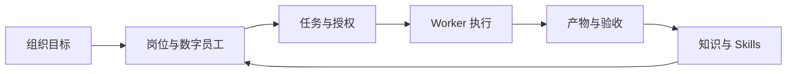

<p align="center"></p>

# EvoHarness

**面向数字员工的 AI Native 组织系统。**

让人和数字员工围绕共同目标协作：配置组织与岗位，委派有验收条件的任务，在授权与预算内执行，再把交付中积累的知识和方法沉淀为可复用的能力。

[](https://github.com/Nagrax/EvoHarness/actions/workflows/ci.yml)
[](https://www.python.org/)
[](LICENSE)

## 从目标到交付

- **组织与员工**：业务单元、岗位、任职、业务空间与权限。人和数字员工使用同一套组织模型，支持暂停、离任和接管。
- **工作与验收**：目标、里程碑、任务依赖、Worker 租约、隔离执行、预算、产物与测试回执。执行完成后进入验收，失败和等待有明确状态。
- **知识与学习**：带来源与版本的知识、按组织和岗位范围复用的 Skills、反馈沉淀、候选评测、晋级与回滚。

Web 工作台、CLI 和飞书接入共享同一套任务、授权与交付记录。Agent Harness 是数字员工的执行基础，提供 OpenAI / Anthropic 协议、工具与 MCP、上下文折叠和长期记忆。



## 快速开始

需要 Python 3.11+。代码任务的 shell 与检查器使用 Docker 隔离，先拉取 `python:3.13-slim`；其他测试工具及 Node.js 按工作内容安装。

```sh
git clone https://github.com/Nagrax/EvoHarness.git
cd EvoHarness
python -m venv .venv
```

激活环境：Windows PowerShell 使用 `.venv\Scripts\Activate.ps1`，macOS / Linux 使用 `source .venv/bin/activate`。

```sh
python -m pip install -r requirements.txt
python -m evoharness --db sqlite:///data/org.db init
python -m evoharness --db sqlite:///data/org.db serve
```

打开 [localhost:8800](http://127.0.0.1:8800)。初始化会写入可重复创建的合成组织：两个业务单元、三类岗位、人和数字员工、目标、任务依赖及知识。默认组织为 `org-demo`，演示身份为租户 `local`、本人 `founder`。

模型配置可在工作台填写 API 地址、Key 和模型；需要后台 Worker 调用模型时，复制 `.env.example` 为 `.env` 并填写 `API`、`APIKEY`、`MODEL`。

另开终端运行执行器，使用同一个数据库：

```sh
python -m evoharness --db sqlite:///data/org.db worker --daemon --profile live
```

Worker 只消费已入队并具备有效授权的 Run；初始化样例不会自动发消息或启动模型任务。`--profile fake --once` 可用于离线检查执行链路。

```sh
python -m evoharness --db sqlite:///data/org.db org view
python -m evoharness --db sqlite:///data/org.db work view --tenant local --owner founder --org org-demo
python -m evoharness --db sqlite:///data/org.db doctor
python -m evoharness --help
```

## 按需接入

- **飞书**：消息、群聊 @ 触发、审批卡片、日报与个人 OAuth 是同一产品的渠道能力。见[飞书接入](docs/飞书机器人使用手册.md)。组织核心可独立启动。
- **CLI 对话**：`python -m agents.main`；支持计划模式和会话恢复。
- **桌面窗口**：`python desktop.pyw`；复用相同 Web 与执行运行时。
- **Docker**：`docker build -t evoharness .`；部署配置、持久化与恢复见[运行说明](docs/OPERATIONS.md)。

共享部署需配置 `EVOHARNESS_HOSTED_TOKEN` 或注册主体令牌；岗位授权、任务审批与个人发送身份分别校验。配置模板中的示例值需替换为自己的配置。

## 开发与验证

```sh
python -m pip install -r feishu-daily-agent/requirements-dev.txt
python eval/digital_employee_gate.py --jobs product --output-dir /path/to/gate-output
```

产品门禁运行核心、飞书和集成三套回归，隔离测试配置并核对测试数。CI 覆盖 Linux / Windows 与 Python 3.11 / 3.12；Linux 容器执行场景在 Linux 门禁强制核验，Windows Server 运行其余原生回归。历史模型实验和真实渠道验收通过独立任务运行，缺少实验数据不会被标为已验证。

```text
evoharness/          组织、工作、授权、知识与应用服务
agents/              模型执行、工具、记忆与 Skills
server/ frontend/    Web API 与工作台
feishu-daily-agent/  飞书渠道与个人身份适配
integration/        渠道事件与任务桥接
ops/                进程监督、备份与恢复
tests/ eval/         回归测试与评测工具
```

本地合成组织与离线回归可直接体验；真实飞书权限、本人 OAuth、自动发送试点及长期运行验收仍依赖实际配置和运行结果。历史 benchmark 数字不代表当前版本的组织交付能力。

开发入口与约束见 [Agent 导航](docs/AGENT-HANDOFF.md)。许可证：[MIT](LICENSE)。
