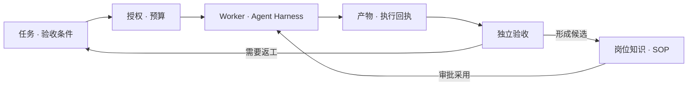

<p align="center"></p>

<h1 align="center">EvoHarness</h1>

<p align="center"><strong>自托管的数字员工工作台与 Agent Harness</strong></p>
<p align="center">
  <a href="https://github.com/Nagrax/EvoHarness/actions/workflows/ci.yml"></a>
  <a href="https://www.python.org/"></a>
  <a href="LICENSE"></a>
</p>
<p align="center">
  <a href="https://47.106.200.90/">在线演示</a> ·
  <a href="#快速开始">本地体验</a> ·
  <a href="#运行数字员工">运行数字员工</a> ·
  <a href="#接入-webcli-与飞书">集成入口</a> ·
  <a href="#评测与复现">评测</a> ·
  <a href="docs/OPERATIONS.md">部署手册</a>
</p>

在 EvoHarness 中，你可以把目标拆成工作项，分配给人或数字员工，审批执行并验收交付。数字员工使用 EvoHarness 原生运行时，具备工具、MCP、会话记忆和可演进的 Skills。工作台、CLI 与飞书共用组织、工作、知识及交付记录。

[在线演示](https://47.106.200.90/)可直接查看合成组织的任务、岗位、审批和知识。正式工作区通过 HTTPS 登录。

## 快速开始

Python 3.11+ 即可启动演示工作台。初始化会创建任务、岗位和示例知识。

```sh
git clone https://github.com/Nagrax/EvoHarness.git
cd EvoHarness
python -m venv .venv
```

在 Windows PowerShell 运行 `.\.venv\Scripts\Activate.ps1`，在 macOS 或 Linux 运行 `source .venv/bin/activate`。

```sh
python -m pip install -r requirements.txt
python -m evoharness --db sqlite:///data/org.db init
python -m evoharness --db sqlite:///data/org.db serve
```

1. 打开 [localhost:8800](http://127.0.0.1:8800/)。
2. 点击「设置身份」，租户填 `local`，本人填 `founder`。切换到「组织工作」，组织 ID 填 `org-demo`。
3. 打开演示任务，可以看到负责人、状态和后续动作。「组织」展示岗位与任职，「目标」展示里程碑及覆盖的任务。

也可以在 CLI 读取同一份数据。下列命令输出 JSON，适合脚本与 Agent 调用。

```sh
python -m evoharness --db sqlite:///data/org.db work view --tenant local --owner founder --org org-demo --json
```

## 一次任务如何推进

例如，支持岗位收到「登录超时」问题，创建带验收条件的任务。经批准后，Worker 在对应业务空间检索岗位知识和 Skills，执行并提交产物。验收人核对产物与检查结果，决定交付或返工。反馈可形成供后续任务采用的 SOP 候选。



| 你在管理的对象 | EvoHarness 如何处理 |
| --- | --- |
| 组织与目标 | 业务单元、岗位、任职、空间和目标在同一数据模型中。暂停、离任或接管可通过任务与授权记录追溯。 |
| 执行与交付 | 批准绑定任务版本及载荷。Worker 用租约领任务，保存检查点、产物和回执，再交给验收人。 |
| 岗位知识 | 每条事实保留来源、版本和冲突记录。检索按主体和空间裁剪，验收再次核查所用来源。 |
| Skills 与 SOP | 记录任务实际加载的 Skills。反馈可形成候选，采用受作用域约束，后续评测决定晋级。 |
| 成本与对外动作 | 模型调用先预留 token，再按回执结算。外部发送使用 outbox；回执未知时进入对账。 |

## 运行数字员工

**配置模型。** 将根目录的 `.env.example` 复制为 `.env`，填写 OpenAI 或 Anthropic 兼容服务的实际地址、Key 和模型 ID。Web 与后台 Worker 读取根配置。浏览器的模型设置用于对应的交互请求。

```dotenv
API=https://your-provider.example/v1
APIKEY=your-api-key
MODEL=your-model-id
EVOHARNESS_DATABASE_URL=sqlite:///data/org.db
```

**设置预算。** 组织和执行空间都需要额度。下面用演示组织的支持空间举例。

```sh
python -m evoharness budget set --org org-demo --actor founder --tokens 100000
python -m evoharness budget set --org org-demo --space space-support --actor founder --tokens 50000
python -m evoharness budget view --org org-demo
```

**启动 Worker。** 在另一终端激活同一虚拟环境，从项目根目录运行。

```sh
python -m evoharness worker --daemon --profile live
```

在「工作」中打开已有任务，核对目标与验收条件后点击「批准并启动」。新任务可用 `python -m evoharness work create --help` 查看创建参数。执行回执可以从任务详情追溯，队列和租约可用 `python -m evoharness worker --health` 检查。

**运行代码任务。** 安装并启动 Docker，再构建默认 Python 检查镜像。也可以使用包含目标项目依赖的工具镜像与检查镜像。

```sh
docker build -f ops/Dockerfile.checker -t evoharness-checker:latest .
```

隔离检查记录完整的 pytest 收集与 JUnit，核对原有测试、参数化用例和辅助文件。镜像配置与运行权限见[运行说明](docs/OPERATIONS.md)。

## 原生 Agent Harness

同一个运行时支持交互式任务和后台执行。个人对话可通过 `python -m agents.main` 启动，也可以从工作台进入「对话」。

| 运行时模块 | 提供的能力 |
| --- | --- |
| [Agent Loop](agents/agent.py)与[会话折叠](agents/session_memory.py) | 模型调用、工具反馈、长会话压缩和跨轮续接。Web 实时展示文本、工具步骤与用量。 |
| [工具](agents/tools.py)与 [MCP](agents/mcp_client.py) | 工具调用、MCP stdio 扩展以及执行权限。组织 Worker 还能使用任务级隔离的代码工作区。 |
| [长期记忆](agents/memory.py) | 以 Markdown 持久化，按候选清单和相关性选取，控制注入上下文的大小。 |
| [Skills](agents/skills.py)与[评测](agents/online_skill_eval.py) | 检索并加载技能，跟踪使用窗口、评测和候选版本。在「能力」中查看作用域和技能状态。 |
| [Skill Search](agents/skill_search/controller.py) | 在冻结评测协议下生成候选并按评测结果保留或淘汰，检查点支持恢复。 |

## 接入 Web、CLI 与飞书

| 入口 | 如何调用 |
| --- | --- |
| 工作台 | `python -m evoharness serve`，按工作项查看组织、目标、审批、能力和知识。 |
| CLI | `python -m evoharness work --help`，支持查看、创建、批准、派工、验收、接管和证据读取。 |
| HTTP / Agent | `GET /api/work/schema` 提供工作操作契约。读接口包括 `GET /api/work/view` 和 `GET /api/work/evidence`，动作提交使用 `POST /api/work/op`。 |
| 飞书 | [飞书接入手册](docs/飞书机器人使用手册.md)涵盖事件接收、日报、审批和本人 OAuth。群聊可设为仅 @ 触发。 |
| 桌面 | `python desktop.pyw` 打开复用 Web 的本地桌面窗口。 |
| 自托管 | [部署与运维](docs/OPERATIONS.md)覆盖 Docker、常驻服务、主体令牌、持久化和备份恢复。 |

本机默认监听 `127.0.0.1`。多进程部署使用绝对数据库路径，并让 Web、Worker、飞书指向同一数据库。共享部署由可信主体令牌与当前成员资格确定授权。

## 评测与复现

| 要验证什么 | 从哪里开始 |
| --- | --- |
| 产品行为 | [产品门禁](eval/digital_employee_gate.py)运行核心、飞书和集成回归。CI 覆盖 Windows / Linux、Python 3.11 / 3.12，保留 JUnit、日志及跳过项。 |
| 单次运行与交付 | [Worker 评测入口](eval/worker_run.py)记录实际执行、产物、检查或使用回执。 |
| Agent 解题与记忆 | [GAIA / HLE runner](eval/run_benchmark.py)和[记忆评测](eval/memory_eval.py)提供可复跑入口。数据与模型依赖按实验配置准备。 |
| Skill 候选质量 | [Skill Search 评测](eval/skill_search_eval.py)提供冻结样本、候选运行和结果检查。 |

```sh
python -m pip install -r feishu-daily-agent/requirements-dev.txt
python eval/isolation_coverage.py prepare
python eval/digital_employee_gate.py --jobs product --output-dir /path/to/gate-output
```

离线门禁验证约定与回归。真实渠道、自然周期、人工判分与模型效果使用各自的验收证据。冻结实验档案通过部署环境单独提供，CI 在档案缺失时报告未执行。

## 开发与贡献

```text
agents/              Agent Loop、工具、会话、记忆、Skills
evoharness/          组织、工作、授权、预算和岗位知识
server/ frontend/    Web API 与零构建工作台
feishu-daily-agent/  飞书渠道与个人身份
integration/        渠道桥接和集成回归
ops/                进程监督、隔离检查、备份与恢复
eval/ tests/         评测入口、测试与验收门禁
```

请从[开发导航](docs/AGENT-HANDOFF.md)定位模块。提交问题时附上脱敏后的错误码、可复现步骤和运行版本。修复缺陷时附回归测试。

[MIT License](LICENSE)
