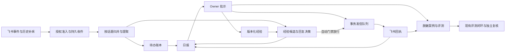

# EvoHarness 飞书日报与经验回复落地指南

2026-11-06 · 实施交接 · 工单和阈值为待验证的设计基线

配套[工单清单](feishu-delivery/tasks.json)可交给现有带租约的执行器。已有[评测接管手册](CLOSED-LOOP-TAKEOVER.md)负责通用评测的运行与取证。本文负责飞书产品契约、增量门禁与上线顺序。

## 1. 交付目标

每天同步用户授权且平台实际可访问的会话，把对话中的请求、承诺、进展和解决办法整理成可追溯的记录。用户在飞书日报看到仍需自己处理的事项、待批回复、已经发出的回复以及待验证的经验。用户能在同一入口修改并批准回复、纠正已发回复关联的经验、标记任务完成或停用经验。经验证的重复问法，可以在限定范围内用同一版本的解决方案自动回到原对话。

交付必须跑通这条复验链：测试对话中提出一项有后续更新的待办和一条重复问题 → 次日收到一张日报 → 批示草稿及验证经验 → 相似新问题走受限自动回复 → 在日报纠正已发回复并停用旧经验 → 新来信转人工或使用明确批准的新版本。每步可查原消息、操作者、经验版本、发送回执和生效时间。任务跨天保留，采集缺口在日报可见。

### 运行模式

| 模式 | 真实飞书读写 | 放行条件 |
| --- | --- | --- |
| 离线 | 合成事件、录制的脱敏 fixture、假时钟、假模型与假传输 | 工程默认测试入口 |
| 只读与影子 | 读取已授权来源，允许向 owner 发送日报，业务回复只生成决策和草稿 | 真实读权限矩阵、日报收件人和部署配置已确认 |
| 逐条批准 | owner 审核具体回复版本后，向批准的原会话发送 | 审批身份、发信身份、重复回调和故障恢复均通过 |
| 白名单自动 | 只在许可会话和 FAQ 类别发送已放行版本，日报展示实际发送结果 | 固定留出集、影子试点、风险门禁和 owner 的模式放行 |

采集许可、向 owner 发日报的许可、回复到指定会话的许可各自独立。暂停自动回复后，采集、日报、批示和恢复未完成记录继续运行。模式、来源、回复身份、模型供应商与数据保留期由部署配置显式声明。首个真实试点用机器人身份、测试群与机器人私聊。自然人私聊读取走单独的用户授权验证，是否启用以验证结果和 owner 配置为准。

## 2. 现状与审计

| 对象 | 已核对 | 对落地的影响 |
| --- | --- | --- |
| EvoHarness `c25af95` | CLI、Web 与 MCP 共享运行时。已有 BM25 检索、在线经验抽取、使用证据与成绩样本、分区、审计、人工晋级和回退。见 `README.md`、`agents/skills.py`、`agents/skill_tiers.py`、`agents/online_skill_evolution.py`。 | 复用运行时的模型调用及可验证的检索或评测接口。飞书 FAQ 有受众、有效期和发送许可，采用独立领域记录与索引命名空间，通用 Skill 的可检索状态不能授予发信权。 |
| 飞书原型 | Python + 飞书 SDK + SQLAlchemy + SQLite，已有事件、历史拉取、分类、匹配、卡片、审批。目录当前为未跟踪输入。临时副本上六个服务层测试通过，模型与发信为 mock，fixture 会 `drop_all`。 | F00 冻结原型来源和测试基线，测试使用绝对路径临时 DB、假身份与网络隔离。保留六例的覆盖和断言强度，增补真实入口、并发、权限、崩溃和回执回归。 |
| 实时入口与历史入口 | `handlers/events.py` 先投递内存线程池，实时分支没有使用 `daily.py::_chat_allowed`。后者把抓取失败跳过，仍可生成日报。`IncomingMessage.mentions_bot` 在机器人 ID 未知时接受任意 @。 | 共用确定性准入与持久 inbox。未知身份禁止回复，日报区分空窗口与采集不完整。 |
| 卡片与发信 | `card_callback.py::handle_card_action` 直接信任 `action.value` 的 ID，未核对 operator。`reply_engine.py` 在事务提交前调用 `reply_text`，重复审批可返回终态并显示成功，SDK 请求未设置幂等键。 | 绑定卡片、owner、原会话、对象及版本。审批与 outbox 同事务，卡片即时提示处理状态，以回执确认已发送。 |
| 经验与日报 | `approve_draft` 可覆盖现有标准答案或把草稿经验直接验证。匹配最高分直接用 0.85 判定。`daily.py` 只查昨天标为 TASK 的消息，以宿主时区算窗口，逐条推送历史积压草稿。 | 一次回复与发布经验各自审批，补齐任务生命周期与版本化经验。日报同日幂等、按逻辑日补跑，主卡聚焦行动。 |
| 工程闭环 | 台账 34 个 `done`，`auditor_selfcheck` 8/8、`docs_consistency` 0 issues，根套件收集到 1178 个测试，本轮未重跑根全量。检查器从历史产物读到 `gateTests=1173`，接管手册载有另一次 1178/1176/2 的历史统计。`loop_source_health` 判定红灯，具体为 `failureStability` 产物过期。`tool_reachability` 报告 `probe_readfile_usage.py` 超时及单独归类的 `final_check.py` 除零。默认终端编码下 `loop.py status` 发生 UnicodeEncodeError，显式 UTF-8 后可解析。 | 用同一源码摘要和新鲜证据建立 F00 基线，区分诊断脚本的外部依赖与生产故障。原 `gate.py` 只运行根 `tests/`，源码枚举没有 `feishu-daily-agent/`，必须加飞书独立验证及摘要覆盖。 |

### 飞书能力先验收

`im.message.receive_v1` 的覆盖受订阅权限限制。机器人群列表也不能充当个人单聊索引。历史读取走指定会话或话题接口，用户身份的单聊与群聊需要相应 scope，普通群的话题回复须按 thread 获取。真实范围由逐会话探针测得。 [接收事件与消息 API](https://open.feishu.cn/document/uAjLw4CM/ukTMukTMukTM/reference/im-v1) · [会话历史接口](https://open.feishu.cn/document/uAjLw4CM/ukTMukTMukTM/reference/im-v1/message/list)

先准备带标记的测试消息和授权范围表。逐项记录来源类型、会话如何发现、事件覆盖、历史覆盖、读写 token 身份、scope、是否能在原话题回复、编辑和撤回如何发现、限制及样本验证时间。至少覆盖机器人私聊、群内 @ 机器人、群内无 @、同群话题、用户授权自然人单聊、权限撤销和无权限会话。读探针与发信探针分开执行。个人单聊优先用已有授权应用可证实取得的会话 ID，并验证发现率及 OAuth 刷新/撤权。来源无法枚举时支持 owner 明确登记经验证的会话。读取仍不可用的来源保留为缺口，可以在确认有授权导出接口及合规数据路径后评估导入补充。日报以覆盖清单说明缺口。读取许可无法转换成写入许可。每种对外发送身份、接口与幂等期限需要在试点前实测或通过官方接口契约验证。 [回复消息接口](https://open.feishu.cn/document/uAjLw4CM/ukTMukTMukTM/reference/im-v1/message/reply) · [回调身份](https://open.feishu.cn/document/event-subscription-guide/callback-subscription/callback-overview)

### SuperAgent 对标结论

2026-11-06 复查 `git ls-remote`、官方仓库和浅克隆。官方 HEAD 与 main 均为 `8c32a9dc5d72c033816c6a8110b37f40cf94fba4`，与 [本地对标笔记](design/对标笔记_dsh-superagent_2026-11-06.md) 一致，官方仓库无 release，远端无 tag。其飞书适配基于 bot，部署约束排除可作为用户发消息的 CLI。原型代码和文档能支持以下迁移判断。 [官方快照](https://github.com/deepseek-ai/dsh-superagent-prototype/tree/8c32a9dc5d72c033816c6a8110b37f40cf94fba4) · [飞书部署](https://github.com/deepseek-ai/dsh-superagent-prototype/blob/8c32a9dc5d72c033816c6a8110b37f40cf94fba4/docs/006-deployment.md)

| 笔记建议 | 复核与调整 | 工单 |
| --- | --- | --- |
| E1 抽取窗口落盘 | `agent.py::_pop_pending_skill_extraction_window` 消费内存窗口，`_auto_save` 未持久化。保存窗口还需同时记录领取与完成，覆盖 CLI 恢复和 Web 复用/淘汰。仅做旁路 JSON 会留下双写间隙。 | EH01 独立验证。飞书用业务 inbox，避免依赖 CLI 会话存活。 |
| E2 durable Effects | 上游有事务内持久化、提交后分发、`Later`、重试和 `generation` 防旧 worker 清理新 payload。队列合并适合可替换任务。回复指令冻结目标、正文与版本，不能用新的 payload 覆盖在途发信。三次失败告警适合普通任务，权限违规和回执不明立刻可见。 | F03 优先交付业务 outbox，EH02 再验证抽取/使用记账是否值得复用。 [Effects 源码](https://github.com/deepseek-ai/dsh-superagent-prototype/blob/8c32a9dc5d72c033816c6a8110b37f40cf94fba4/src/app/effects.ts) |
| E3 文档可查与可测 | 本文记录设计取舍。沿用 `docs_consistency` 的证据核对，优先验证工单依赖、流程入口、证据新鲜度。 | F00、F07 |
| E4 纯函数判定 | 先让飞书授权与回复决策产出确定的 reason code，再用黄金样本证明核心旧规则等价后考虑重构。 | F06、EH02 |
| E5 Source 与两级准入 | 借鉴硬 gate 后做模型研判。飞书扩展为授权采集、模型可读、发送及学习四个独立判定。 | F02、F06 |
| E6 prompt 可追溯 | 单个 session 最后一次 revision 不足以回放。对每次提取/分类/生成落模板、模型、策略、检索索引版本与数据快照 ID。记录脱敏输入摘要或哈希。 | F04、F05、F07 |

本文采用独立进程健康检查、受限预生成作为可自研机制。健康检查由服务主管或外部探针读取 heartbeat、最后成功水位、积压年龄和调度漏跑，首期用现有 OS 服务管理器重启及报告故障。受限预生成只生成影子草稿，同一消息修订、经验版本和策略版本决定缓存键，失效即丢弃，有配额并单独统计等待时间与浪费率。源码与文档扫描未发现上游 prototype 对投机执行、外部 Watchdog、BYOM 的实现，性能收益须用飞书试点自己的数据验证。平台部署保持单租户单实例 SQLite，观测到吞吐瓶颈或有明确高可用要求后再评估存算分离。Ticket/Mandate/通用多 Session 编排会增加状态源，当前由已有执行器、来源策略和业务表覆盖。 [上游架构与范围](https://github.com/deepseek-ai/dsh-superagent-prototype/blob/8c32a9dc5d72c033816c6a8110b37f40cf94fba4/docs/007-architecture.md)

## 3. 产品与数据契约



### 采集、任务与日报

- 来源配置至少绑定 tenant、owner、chat/thread、读身份、允许内容类型和独立的回复许可。长连接回调短事务持久化后确认，实时和补采使用同一 intake。忽略应用自身输出及控制指令正文的普通训练入口。身份未知、空白名单和撤权按关闭处理。正文落盘前最小化，原始 payload 按需短留，记录范围撤销、过期与删除传播。模型只接获准的脱敏上下文，消息正文和引用当数据处理。
- 原始消息按 `tenant + message_id` 去重，保留来源集合、编辑/撤回标记、版本和 UTC 时间。每来源维护窗口、分页进度、上次成功水位和结果枚举 `complete/partial/unavailable`。持久保存页后推进；整窗成功后封口。失败恢复从已保存页继续或重扫重叠窗口，去重落库，补采区间在本地按毫秒二次裁切。水位与任务/回复消费进度分开。已撤回内容停止学习并失效相关候选或已发布经验，保留脱敏审计指针。编辑后重算受影响对象，旧草稿作废，已发回执保留。
- 归并以会话与话题为界，连同相关上下文识别请求、自己的承诺、归属、完成、取消、变更和再次打开。模型产出证据消息 ID、行动、归属、期限及不确定标记。缺证据或负责人不明进「待确认」，用户标记完成的事项只能通过后续可追溯信号或人工重新打开。任务按稳定 ID 保存状态 `needs_confirmation/open/done/cancelled`，跨天保留未完事项，来源跳转或受控证据详情可回查，未知日期留空。
- 按话题与修订版缓存有效模型结果。部署配置给模型调用设每日预算、超时和并发上限，逐次记账。预算耗尽时继续落盘及补采，报告尚未完成的提取和分类，保留已有待办，待预算恢复后补算。
- 日报键为 `tenant + owner + logical_date + timezone`，首期 Asia/Shanghai 08:30 总结上一自然日，叠加当前未结事项。以首次/末次成功采集的快照和版本生成，重复调度复用日报及发送意图，晚到数据更新同一日报或提供可追踪补记。发信明细按真实回执时间归属，延迟单独展示。卡片顺序为「我待处理」「待批回复」「已发回复」「经验变更」，缺口仅在发生时显示。长列表按需展开或分页。每条只展示行动所需摘要、来源、状态与操作，避免逐条刷屏。

### 回复、批示与投递

- 决策返回 `skip/draft_only/needs_review/auto_eligible` 及 reason code。自动放行同时满足目标在许可范围、真实触发、发送身份可信、来源新鲜、经验版本已发布且适用、结果满足规则和阈值、无冲突与敏感内容、无重复发信以及开关打开。历史补采只更新待办、经验或草稿。把相似度和策略安全判定分别记录。高相似异意图、经验冲突、用户专属信息、敏感内容和模型故障转人工。首期自动回复使用批准的短模板和允许字段，禁止凭空承诺、执行工具及临时生成新事实。
- 卡片只给 owner，回调从受信事件取操作者，绑定 tenant、owner、card、目标、动作、版本、有效期与一次性 action ID。原子比较对象版本并写 ReviewEvent。支持批准、修改后发送、拒绝、纠正已发关联经验、验证/发布、暂停、恢复旧版本以及待办完成或重开。批准只授予当前回复版本。拒绝需标原因，区分场景不适用、措辞和答案错误。已发回复的纠正生成候选并可暂停旧经验，历史原文与回执保留。若需补发更正，生成单独的待批动作。
- 业务状态变更与 outbox 在一个事务内。回复以 `tenant + target_message_id + intent_kind` 锁住唯一发送意图。日报以逻辑日键锁住，补发/更正有独立受控意图。行含不可变正文或引用、内容摘要、策略版本、稳定 provider 幂等键、attempt、next_at、领取 token、租约和回执。SQLite 单 worker 试点仍用原子领取与带 token 的条件完成，重启可接手。提交后才发信，执行前复核撤权、暂停、过期、撤回及当前经验版本。记录 `queued/sending/sent/retry_wait/delivery_unknown/failed/cancelled`。429、临时网络故障按退避加抖动和已知安全的重试边界处理，永久错误直接隔离。发信超时或「远端成功、本地回执未落」时，仅在已确认幂等契约内复用同一键，否则停在 `delivery_unknown` 对账，禁止盲重发。只有真实 `sent_message_id` 或可核对的远端回执才显示已发送。

### 经验如何增长

沉淀两类东西。常规进展进入待办与日报。可复用解法从 owner 的真实答复、人工更正或明确采纳的解决结果中抽取，以问题簇管理。提取输入包含问题、上下文、回答与结果证据。单纯重复提问、模型自己生成的回答或未收到反馈，不构成正确性的独立证据。候选经验最少有 `intent_id`、代表问法、易混淆负例、适用人群/会话、先决条件、解决步骤、允许引用链接、来源 ID、敏感级别、有效期、前版与修订理由。用户专属数据留在授权范围，公开 FAQ 用经过批准的可分享表述。

经验状态为候选 → 可辅助拟稿 → 已批准自动 → 暂停/过期；版本不可原地修改。先用结构化条件与已有 BM25 候选召回，抽样比较原型关键词和 embedding 的增益、数据出境路径与成本，再决定是否采用。问题簇冲突时分拆条件或进入待批。保留检索排名、实际采用、拒绝理由和后续纠正的分母。承接 EvoHarness 双池思想，经验出生依据、调参案例和留出成绩分开。迭代只能生成候选，owner 可以明确发布具体经验版本并回滚，回滚时同步重建或切换索引快照。模型、提示词、经验、策略任何一项变更均可定位到对应决策。

首期保存 SQLite 业务事实及审计，EvoHarness 通过窄接口接收已脱敏、受控的上下文。建议在 F05 先做一条真实接缝测试，要求飞书入口能调用核心检索/模型能力并保留来源与版本。如果核心检索 API 依赖全局 Skill 状态，先抽出可传入隔离语料的接口。通用 `Agent.run`、工具权限、用户 home 与默认 Skill 目录不参与飞书消息的授权。评测样本由显式脱敏导出进入 eval，授权来源撤回时运行清理与经验影响分析。

## 4. 工程与评测闭环

### 接手与状态

1. 从 [工单清单](feishu-delivery/tasks.json) 读依赖和每项验收。F00 冻结 HEAD、现有未提交改动边界、原型源文件摘要和测试节点基线。先在独立分支/工作树复制明确范围的未跟踪原型，排除 `.env*`、数据库、日志、缓存与运行数据。基线缺失、跳过或失败要注明来源和修复路线。
2. 实施工单由工作区现成 `state.mjs` 驱动，飞书单独使用一个运行根。已有 `eval/loop/BACKLOG.json` 继续收工程发现和修复项，日报业务表只记录运行事实。工程发现关闭时引用工单证据，实施进度只记在此运行根的 `STATE.json`。缺飞书授权仅阻塞依赖真实飞书的工单。
3. 一次领取一项。读取验收 → 先复现缺口 → 实施 → 单元和故障注入 → 双编码根门禁及飞书子门禁 → 独立评审 → 复测 → 封存证据 → `finish`。任何一项失败留失败证据和恢复动作。最长任务持续续租，接手人按 `list` 取下一可执行项，租约过期先核验已落盘结果再认领。评审者从新会话读工单、diff 和证据，逐条核对。自审记录为自审，无法满足独立复核时保持未验收。

以下命令从 EvoHarness 仓库根运行。首次初始化时固定实施工作树路径，后续从同一个运行根恢复，工作树路径改变时迁移到新运行根并保留旧证据。

```powershell
$env:PYTHONIOENCODING = 'utf-8'
$toolRoot = 'D:/claudecode/.zcode/workflows/evoharness-optimize-audit'
$runRoot = 'D:/claudecode/.zcode/workflows/evoharness-feishu-delivery'
$manifest = (Resolve-Path 'docs/feishu-delivery/tasks.json').Path
if (-not (Test-Path -LiteralPath $runRoot)) {
    New-Item -ItemType Directory -Path $runRoot | Out-Null
}
$runtimeManifest = Join-Path $runRoot 'tasks.json'
if (-not (Test-Path -LiteralPath $runtimeManifest)) {
    $spec = [IO.File]::ReadAllText($manifest) | ConvertFrom-Json
    $spec.repo = (Resolve-Path '.').Path
    [IO.File]::WriteAllText($runtimeManifest, ($spec | ConvertTo-Json -Depth 20))
}
node "$toolRoot/state.mjs" --root $runRoot init
node "$toolRoot/state.mjs" --root $runRoot list
node "$toolRoot/state.mjs" --root $runRoot claim F00 implementer-01
```

工作流指令沿用 `heartbeat ID OWNER`、`finish ID OWNER EVIDENCE.json`、`block ID OWNER REASON`、`fail ID OWNER REASON`、`retry ID`、`report`。租约两小时，长验证中至少每 30 分钟续租，合并或提交前核对仍持有租约。已有完成项被新证据推翻时使用 `invalidate ID REVIEW.json`。外部能力未开通用 `block` 并写请求对象、复验条件、剩余替代路径。保留 `STATE.json`、固定版任务定义与审查记录，禁止覆盖后重建完成状态。原执行器的 `overall` 会计算包括可选项在内的所有任务，飞书发布范围按 F00–F09 加范围表逐项验收，EH01/EH02 的实际状态单列。执行器以 `kind` 记录类别，真实读取、发信与生产启用的权限仍由验收和部署侧强制。

### 工程门禁接线

- F00 先跑手册里的四项工具健康检查与原全量门禁。根套件用指定 `tests/`，飞书子项目从其目录用独立依赖和 `python -m pytest tests -q`，DB 连接明确指向新建临时文件。对未跟踪原型先做源码/测试清点，随后保留实现前与实现后测试全量 JUnit、skip 原因与节点列表。现有测试会间接查询机器人身份，测试接线应注入固定机器人身份并在传输层禁网。
- F00 在飞书运行根准备本地 `gate.py`，沿用原 gate 的 `run/snapshot` 契约与基线校验，增量纳入飞书源码、依赖锁、迁移、fixture 和评测契约。两边测试产物分别记录，根原有 node IDs 与失败/跳过规则继续独立核对。聚合报告保留原 `version/taskId/sourceDigest/endSourceDigest/ast/runs` 结构，两编码 `runs` 包含根节点和带命名空间的飞书节点，单独保留 root 与 feishu 子门禁记录。任一子门禁失败或缺失令整体红灯。执行器会从运行根调用 `gate.py snapshot` 核对摘要。摘要排除可变台账、证据输出和私密数据，验证飞书源改动能触发 stale-source，验证负例失败能阻断 finish。F00 自身先实现并证明这条检查链，再用它验收自己。
- 工单目录至少留 `implementation.json`、`gate.json`、`review.json`、`evidence.json` 和专属验收报告。前三者 taskId 相同，implementation 标 `status: implemented` 并填真实 implementerId，gate/review 含同一个 sourceDigest、`ok: true`，review 含真实 reviewerId、implementerIds、`independent: true` 与空 blockingFindings。evidence 给这三份文件的 path/sha256 描述，gate/review 描述也带 `ok: true`。工单专属证据及核验结论写进 review，含 fixture/replay 版本、报告 hash、失败分母和 live probe 状态。运行根下按 task/attempt 分目录，敏感原文和凭据不进入公共仓库或评测产物。交付前执行 `python eval/git_preflight.py`。
- F07 给 `eval/loop.py collect` 增加飞书评测信号，先以独立 `--check` 验证，再接入 source-health 和可达性测试。信号输出严重度、指纹、失败 case、复现命令、产物/来源摘要与更新时间。过期或没有运行产物应报告未知或坏掉。保留现有 `loop_autorun.py --once` 的 0/3/2 语义。评测及 triage 可以开缺陷，批准、部署、自动回复开关与生产经验发布由各自运行时授权。

### 验收矩阵与建议阈值

F07 由 owner/域标注人确认黄金标签和重要待办定义。先冻结 case 和时点再调模型。按会话、问题簇、时间块隔离训练/开发/留出，覆盖同问不同表达、高相似反例、跨群歧义、任务后续完成、日报迟到、回调重放、越权、注入、限流、崩溃和恢复。评测至少比较原型静态规则、无经验、候选经验与版本化经验，使用相同输入和可比的生成设置。回放以 case 或独立簇统计，报告分子/分母、样本覆盖、失败清单和适当区间。模型评分仅补充人工或确定性断言。

| 闸门 | 提议的初始验收 |
| --- | --- |
| 数据与执行硬门 | 安全、幂等、重启、撤权、跨会话泄露及来源追溯用例全部通过。错误收件人、未经授权的写操作、重复发送、敏感泄露、关键任务无声漏采均为 0。测试覆盖回执到达前后、卡片重复点击和模型不可用。 |
| 日报与待办 | 已知窗口内的合成消息 100% 可核对，所有采集失败正确标缺口。固定留出集 owner 待办 precision ≥ 90%、recall ≥ 90%，关键待办 recall 100%，虚构期限和错误归属的严重案例 0。区分明确待办与待确认。 |
| 经验检索与草稿 | 统计按问题簇的 Recall@3、错误高分率、草稿采纳率及更正率。对同一批 case 报告有/无经验差异，人工评审证据支持、适用条件与可执行性。 |
| 白名单自动 | 至少 7 个实际日报周期的影子运行，含至少 60 个经人工裁决、来自独立或分组统计的自动候选。只把系统会实际发出的候选纳入 precision 分母，同时报告全部合格问题上的 coverage。以独立单位计算单侧 95% precision 下界，首期目标 ≥ 95% 且严重错答 0。若按独立 Bernoulli 单元统计，60/60 的精确下界约 95.1%，同簇相关样本不能凑满 60。样本不足继续影子/逐条批准。 |
| 灰度与运营 | owner 确认人、群、FAQ 类别和上限后，先用单一白名单场景与少量经验，建议每天每会话至多 3 条自动回复。看实际重复、未确认投递、采集水位、日报延迟、改稿率、处理时延和模型成本。严重事件立即切回只读或逐条批准，定位并回放后按同一门槛恢复。 |

上述数字是启动方案的验收提议，F00/F07 冻结后作为约束。如需改变，记录原因、批准人、版本及前后结果，再使用新留出集，防止事后调门槛。

## 5. 交付与接手提示

离线验收可与权限探针分开推进。真实日报依赖飞书应用和 owner 收件权限。受控自动回复还依赖真实发信契约、影子样本和明确灰度放行。最终报告按来源和模式逐项列已验证、待验证、失败和外部阻塞，给复现命令、证据哈希、启停方式、部署运行手册、备份与恢复演练记录。第 1 节复验链须对试点范围走通。若用户要求覆盖的会话仍不可读或不可回，整体需求标为部分交付，并保留对应外部阻塞。

> 请从 `docs/FEISHU-DELIVERY-PLAYBOOK.md` 和 `docs/feishu-delivery/tasks.json` 接管。按手册运行基线检查并领取 F00，保留原型及已有工作树修改，之后由运行根的 `list` 决定下一项。逐项提交实现、双编码根门禁、飞书子门禁、工单专属证据与独立复核。缺真实权限时将对应 live 工单标明阻塞，继续离线工单。优先完成每日待办与批示发信，再用验证通过的版本试点自动回复。每次报告给出已完成工单、证据位置、具体阻塞和下一条命令。
